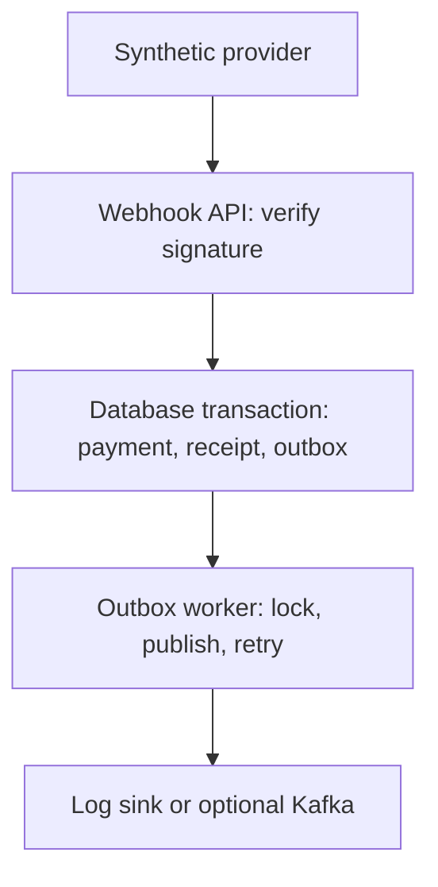

# Payment Webhook Lab

A Java 17 / Spring Boot 4.1.1 portfolio exercise for receiving authenticated payment-status webhooks, preventing duplicate business effects, and publishing committed changes through a transactional outbox.

Created on **15 October 2026** with ChatGPT assistance. This is a new learning project using synthetic data. It is not TCS code, a production payment gateway, a record of prior employment work, or evidence of six months of AI coding experience. See [the assistance log](docs/AI_ASSISTANCE.md).

## Interactive demonstration

The `demo/` directory contains a responsive interactive browser lab with synthetic payments, actual Web Crypto HMAC signing and simulated receipt/outbox state. It is explicitly labelled a simulation, separate from the verified Java API. Run its five behavior tests with `node --test demo/lab.test.mjs`.

## What to demonstrate

- HMAC-SHA256 over the **original request bytes**, with a five-minute timestamp window.
- An event ID reused with different business content returns HTTP 409.
- Duplicate requests and repeated terminal outcomes do not produce another outbox event.
- A payment state change, event receipt and outbox insert commit or roll back together.
- Database row locks serialize transitions on the same payment.
- Outbox workers claim due rows with `FOR UPDATE SKIP LOCKED`, retry with capped exponential backoff, and stop at a configured attempt limit.
- An optional Kafka adapter waits for a broker acknowledgement and partitions by payment ID. The default publisher is a **log sink**, not Kafka.



## Run with Java and Maven

Requirements: JDK 17+ and Maven 3.6.3+. Spring Boot's published requirements are linked in [sources](docs/SOURCES.md).

```bash
python3 scripts/setup_env.py
set -a
. ./.env
set +a
mvn verify
mvn spring-boot:run
```

In another terminal, from the same project directory:

```bash
python3 scripts/demo.py
```

The script reads the ignored `.env` file, creates a synthetic INR 10 payment (1,000 minor units), tests a forged signature, sends the valid event twice, sends a new event describing the same outcome, and checks that a contradictory terminal status is rejected. It prints results and the synthetic payment ID, never keys or signatures.

The default server binds to `127.0.0.1:8080`. The H2 database is persisted under ignored `data/`. Treat H2 as a single-instance demo store, not proof of PostgreSQL behavior. Stop the process with Ctrl+C.

## Run with PostgreSQL and Docker

```bash
python3 scripts/setup_env.py  # only if .env does not already exist
docker compose up --build
```

Run the same Python demo after `/actuator/health` reports UP. PostgreSQL data lives in the `payment-data` volume. `docker compose down` stops the demo and preserves the volume. No automatic destructive reset command is included.

PostgreSQL is reachable only inside the Compose network. The app's published port is bound to host loopback. Keep the local demo private; exposing it publicly requires operational work beyond this exercise.

## API contract

| Endpoint | Authentication | Behavior |
| --- | --- | --- |
| `POST /api/payments` | `X-Api-Key` | Create a synthetic payment: `amountMinor`, `currency` |
| `GET /api/payments/{uuid}` | `X-Api-Key` | Read its current state |
| `GET /api/outbox` | `X-Api-Key` | Inspect up to 100 event delivery states |
| `POST /webhooks/payments` | Signed timestamp and original bytes | Apply, ignore or deduplicate a terminal status |
| `GET /actuator/health` | None | Basic health without internal details |

Webhook headers:

```text
X-Webhook-Timestamp: <Unix time in seconds>
X-Webhook-Signature: <hex HMAC-SHA256(secret, timestamp + "." + raw body)>
Content-Type: application/json
```

Example synthetic body:

```json
{
  "eventId": "evt-demo-001",
  "paymentId": "<UUID returned when the payment was created>",
  "amountMinor": 1000,
  "currency": "INR",
  "status": "SUCCEEDED"
}
```

HTTP responses: 201 for payment creation; 200 with `APPLIED`, `DUPLICATE` or `IGNORED` for accepted webhooks; 400 for invalid data; 401 for authentication failure; 404 for an unknown payment; 409 for an ID/content or state conflict; 413 for a webhook body above 64 KiB. Only `SUCCEEDED` and `FAILED` are valid webhook states. This deliberately small state machine does not model authorisation, capture, refunds, disputes or reconciliation.

## Duplicate and transaction rules

The event ID is unique across the simulated provider. A duplicate means the same ID **and** the same payment ID, amount, currency and status. Whitespace is not business content. Invalid/unknown JSON properties are rejected. A new ID repeating the current terminal outcome is stored as an ignored receipt but does not create another downstream event.

The transaction first locks the payment row, checks the receipt, validates the state transition, inserts the receipt, updates the payment and inserts the outbox row. An ID collision across two different payments can still race; the database unique constraint is the final authority. Its exception is handled **after rollback**, so the winner can be read without using an aborted PostgreSQL transaction.

There is no exactly-once guarantee across the database and Kafka. A process can publish successfully and crash before committing `DELIVERED`. A downstream consumer must deduplicate using `eventId`. Kafka producer idempotence does not remove this application crash window. This implementation also does not guarantee publish ordering between multiple pending events; the current payment model permits only one applied terminal transition per payment.

The worker holds a database lock during publication, with one row per poll and a bounded Kafka wait. That simplifies the exercise at the cost of throughput and longer-lived transactions. A larger system should consider lease-based claiming, bounded retries with jitter, backlog metrics and dead-letter operations. They are design follow-ups, not implemented features.

## Optional Kafka mode

Provide a reachable broker and create the topic `payment-status-events`, then configure:

```text
OUTBOX_PUBLISHER=kafka
KAFKA_BOOTSTRAP_SERVERS=<broker address>
```

Spring accepts environment variables as property overrides. There is no broker in the default Compose file. Real broker delivery, credentials/TLS and a consumer are not part of the verified demo. The adapter has mocked acknowledgement/failure tests. A broker integration run remains pending.

## Tests and CI

```bash
mvn verify
```

The test suite covers state/money rules, signature tampering and expiry, SQL rollback, 16 concurrent duplicate requests, retry timing, dead events, real HTTP requests and the Kafka adapter contract.

Three PostgreSQL tests run only when `TEST_POSTGRES_URL`, `TEST_POSTGRES_USER` and `TEST_POSTGRES_PASSWORD` are supplied. They are skipped otherwise. The GitHub Actions workflow supplies a PostgreSQL 17 service and runs them. **A workflow file is not evidence that CI has passed.** Actual results are in [verification](docs/VERIFICATION.md).

## Next hands-on steps

Follow the [interview walkthrough](docs/INTERVIEW_WALKTHROUGH.md): explain the failure cases, run the demo, change one behavior, and understand its tests before presenting this project. Keep it in a separate portfolio section; do not attach employment metrics or production-scale claims to it.

Publication instructions are in [the GitHub handoff](docs/GITHUB_HANDOFF.md). No repository is claimed to exist until its URL and commit are verified.
