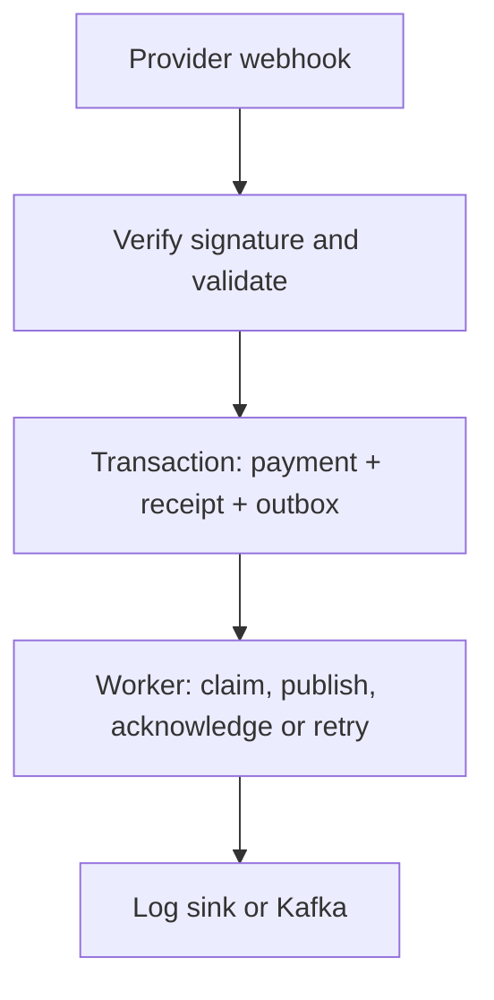

# Payment Webhook Lab

**Java 17 · Spring Boot 4.1.1 · JDBC · PostgreSQL/H2 · Kafka adapter**

A focused backend project for authenticated payment-status events, duplicate handling and reliable downstream delivery through a transactional outbox.

[Interactive demo](https://srreejit-payment-webhook-lab.srreejitbarat.chatgpt.site) · [Architecture](docs/ARCHITECTURE.md) · [API contract](openapi.yaml) · [Verification](docs/VERIFICATION.md)

The hosted demo is an owner-access browser simulation with real Web Crypto HMAC signing. The Java application is a separate runnable service, verified with automated tests and a packaged-JAR HTTP walkthrough. All data is synthetic.

## Engineering highlights

- Verify HMAC-SHA256 against original request bytes with a five-minute timestamp window and 64 KiB body limit.
- Deduplicate by event ID and business content; reject conflicting content with HTTP 409.
- Commit the payment transition, receipt and outbox record in one database transaction.
- Serialize transitions using payment row locks and a unique event-ID constraint.
- Claim due outbox records with `FOR UPDATE SKIP LOCKED`, bounded retries and a dead-event state.
- Publish to a default log sink or optional Kafka adapter keyed by payment ID.



## Quick start

Requirements: JDK 17+, Maven 3.6.3+ and Python 3 for the optional walkthrough.

```bash
python3 scripts/setup_env.py
set -a
. ./.env
set +a
mvn verify
mvn spring-boot:run
```

In another terminal, run `python3 scripts/demo.py`. It creates a synthetic INR 10 payment, rejects a forged signature, applies a success event, deduplicates a replay, ignores a repeated outcome and rejects a contradictory terminal status.

The server binds to `127.0.0.1:8080`. H2 persists under ignored `data/`. Fresh credentials are generated locally and excluded from Git.

### PostgreSQL and Docker

After generating `.env`, run `docker compose up --build`. Wait for `/actuator/health` to report UP, then run the same walkthrough. `docker compose down` stops the demo while preserving its PostgreSQL volume.

## API

| Endpoint | Authentication | Purpose |
| --- | --- | --- |
| `POST /api/payments` | `X-Api-Key` | Create a synthetic payment |
| `GET /api/payments/{id}` | `X-Api-Key` | Read payment state |
| `GET /api/outbox` | `X-Api-Key` | Inspect up to 100 delivery records |
| `POST /webhooks/payments` | Signed timestamp and raw bytes | Apply or deduplicate an event |
| `GET /actuator/health` | None | Basic health |

Create body: `{"amountMinor":1000,"currency":"INR"}`.

A webhook contains `eventId`, `paymentId`, `amountMinor`, `currency` and `status` (`SUCCEEDED` or `FAILED`). Send Unix seconds in `X-Webhook-Timestamp` and the hex HMAC-SHA256 of `timestamp + "." + rawBody` in `X-Webhook-Signature`.

## Tests

```bash
mvn verify
node --test demo/lab.test.mjs
```

The Java suite covers validation, signature tampering/expiry, atomic rollback, concurrent duplicates, retries, real HTTP requests and mocked Kafka acknowledgements. PostgreSQL tests run only with `TEST_POSTGRES_URL`, `TEST_POSTGRES_USER` and `TEST_POSTGRES_PASSWORD`; otherwise they are explicitly skipped. The CI workflow supplies PostgreSQL 17. See [verification](docs/VERIFICATION.md) for observed results and pending checks.

For Kafka, create `payment-status-events` and set `OUTBOX_PUBLISHER=kafka` and `KAFKA_BOOTSTRAP_SERVERS`. The default Compose setup contains no broker.

## Scope and tradeoffs

The state machine supports `CREATED → SUCCEEDED` or `CREATED → FAILED`. It does not move real funds or implement refunds or reconciliation. Delivery is **at least once**: a publish followed by a crash can cause redelivery, so consumers must deduplicate by event ID.

The worker holds a database lock during a bounded publish attempt. Lease-based claiming, jitter, operational dead-letter replay, secret rotation and production monitoring are documented extensions, not implemented features.

Created in October 2026 with AI assistance. [Development notes](docs/AI_ASSISTANCE.md) explain the review approach; [the walkthrough](docs/INTERVIEW_WALKTHROUGH.md) covers the failure cases. This personal exercise contains no employer source code or production payment data.
